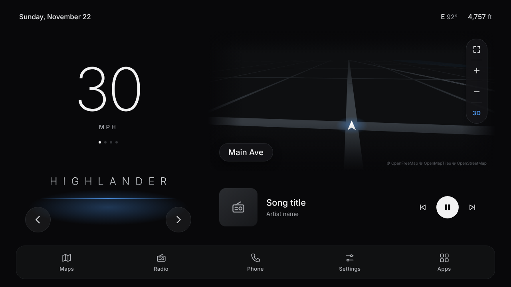
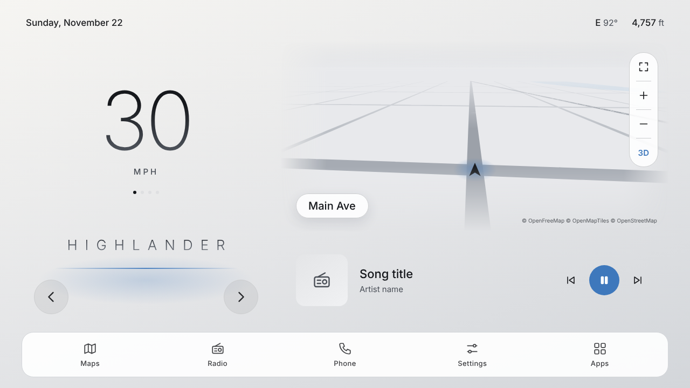
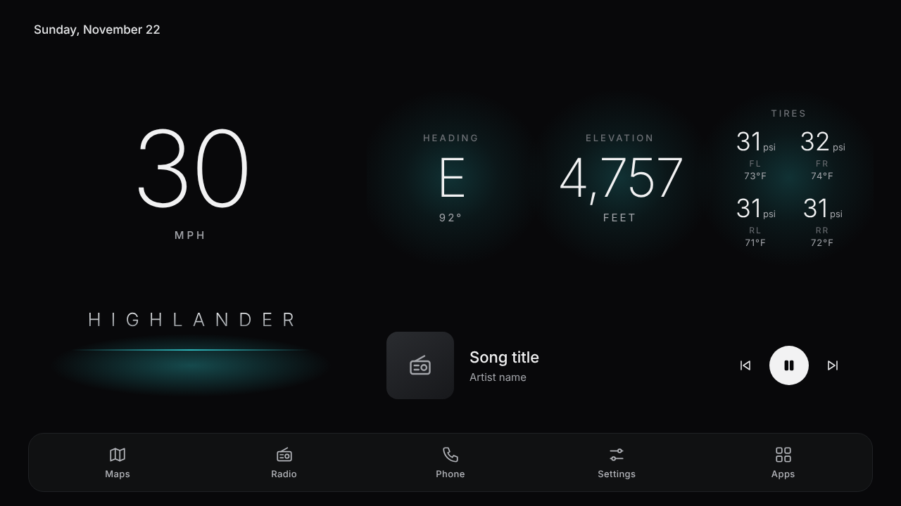
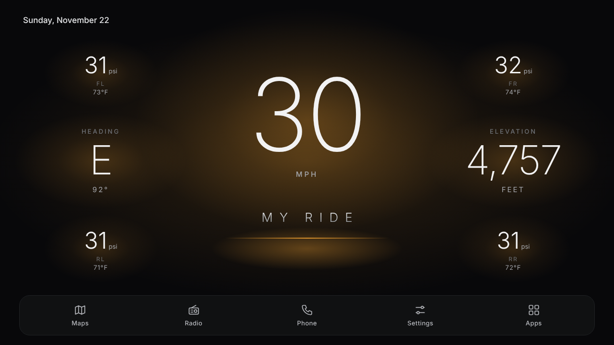
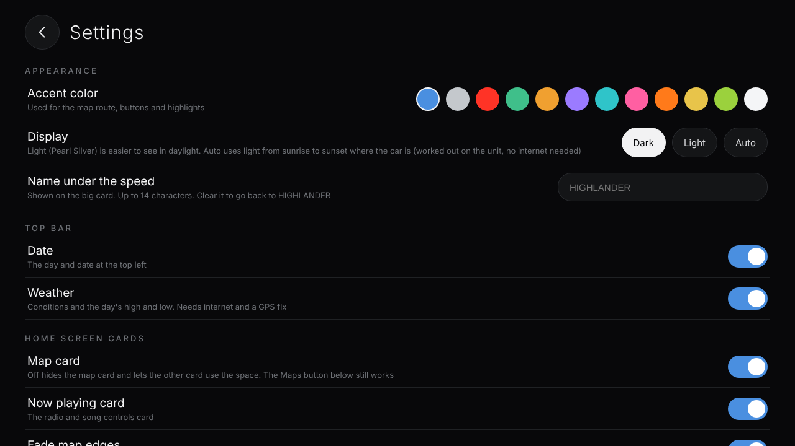
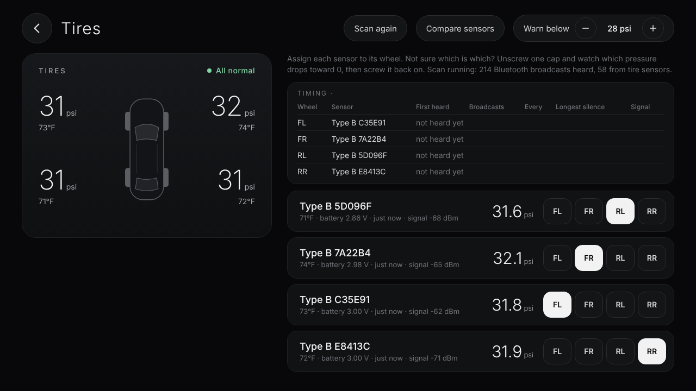
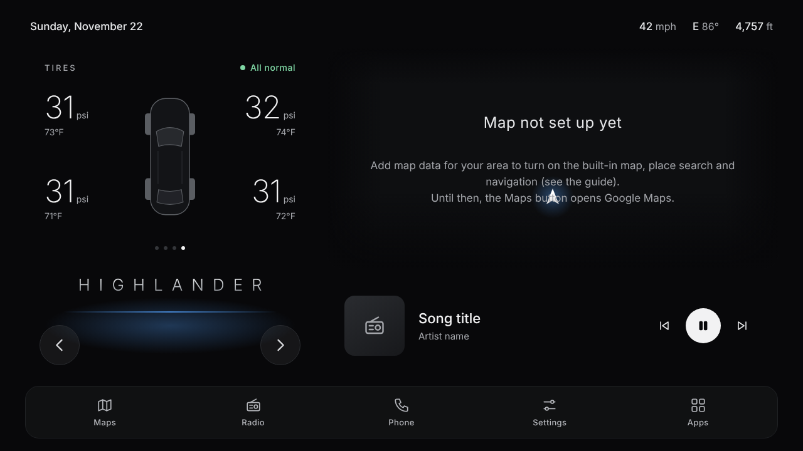
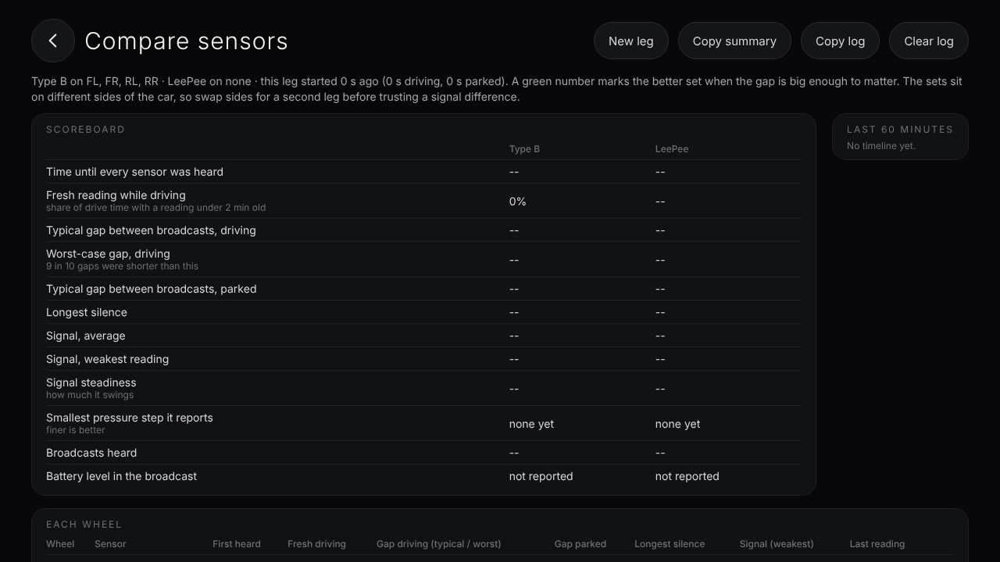
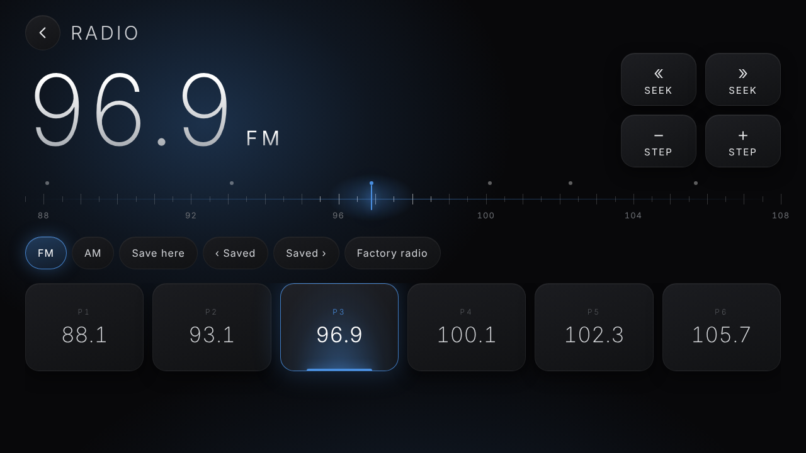
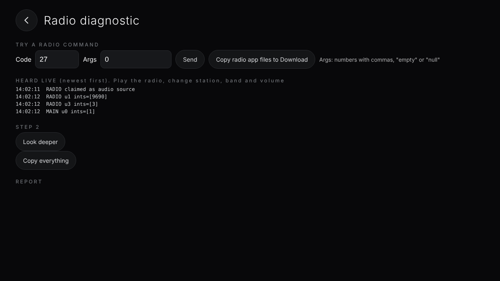

# Building a Custom Head Unit Launcher with Claude

**Just want the app?** Download it from the [latest release](https://github.com/r1cky08/highlander-dash/releases/latest) and see "Try it first" below.

## Read this first

This is a software project, not a wiring project: a custom home screen app, built with Claude, installed on an Android head unit that is already in the car. A few things to know before going deeper:

- **No soldering, no wiring, no root.** Nothing in the car is modified. My unit is not rooted.
- **You need an Android head unit that lets you pick a third-party home app.** Mine is an FYT-based Duduauto unit from Amazon (Android 13, 1280x720 screen). Other units may behave differently.
- **Maps and navigation are Colorado only.** The map data is stored on the unit. Another state would need its own map data.
- **Offline works, but some features need internet.** Navigation and place search work with no cell service. Live traffic, online address lookup and fantasy scores need a connection (a phone hotspot works).
- **You don't need to be a programmer, but you do need patience.** Claude writes the code. The work is describing what you want, testing in the car, and reporting what looks wrong.
- **It is not finished.** Some parts still don't work. The last section lists them so you know what to expect.
- **This is one person's setup.** Everything here worked on my unit. Your screen size, GPS, Bluetooth and launcher settings may differ, and the section on differences covers where.

**Which AI should you use?** I built this with Claude, so that is the only one I can vouch for. The workflow itself is not tied to one model, and you may be able to follow it with ChatGPT, Gemini or another assistant you already use. What matters most is picking one that can handle a large, multi-file project over many sessions. A coding tool that works directly in your project, reads build errors and fixes them (Claude Code, Codex and Gemini CLI are examples) is much easier than copying files back and forth in a chat window, which gets painful as the project grows.

## Try it first: the shared app (Highlander Dash)

Before building anything, you can install a ready-made version of my dashboard and try it on your own unit. It is called **Highlander Dash**. It has my layout, theme and settings, with my personal data and the Colorado-only map taken out. In place of that map it shows an online street map of wherever you are when the unit has internet (the full list is in the next section).

**What you download** (from [github.com/r1cky08/highlander-dash/releases/latest](https://github.com/r1cky08/highlander-dash/releases/latest)):

- `HighlanderDash.apk`: the dashboard, for the head unit
- `TireMonitor.apk`: optional phone app that reads the same tire sensors

**Install it on the head unit:**

1. Connect the unit to the internet (Wi-Fi or a phone hotspot).
2. Open Chrome on the unit and go to the release page above. Tap `HighlanderDash.apk` to download it.
3. Open the download. If Android asks, allow "Install unknown apps" for Chrome, then tap Install.
4. Open **Highlander Dash** from the app list. Allow location (for speed, heading, elevation and weather) and, if you plan to use tire sensors, Bluetooth and nearby devices.
5. Optional: in the dashboard, open Settings, System, Song info access, and allow it so the Now playing card can show what Spotify or another music app is playing.

**Can it be your home screen?** Press the unit's Home button after installing. If Android asks which app to use as Home, pick Highlander Dash and choose Always. If it does not ask, look for "Default apps" or "Home app" in the unit's Android settings, or a launcher option in the car settings. Some units always go back to the factory home screen (mine does). That is fine: Highlander Dash is still just an app. Open it from the app list or pin it as a shortcut, and it works the same.

**Updates and removal.** New versions show up on the same release page; install them over the old one. If you installed a test copy from before build 13, uninstall it once first, because it was signed with a different key. To remove it, uninstall it like any app. Nothing on the unit is changed.

## What's in the app

### Works on any Android head unit

- **Home screen.** A big speed readout (MPH) on the left card with the HIGHLANDER wordmark and a soft glow under it. Tap the card, or the arrows in its bottom corners, to flip between speed, heading, elevation and (once set up) your four tires. The dots show which face you are on.
- **Top bar.** Date on the left, weather (conditions plus the day's high and low) beside it, and heading and elevation on the right. An orange pill appears when a tire is low.
- **Map card.** With internet (Wi-Fi or a phone hotspot), it shows a live street map of where you are, drawn in the same style as the rest of the dashboard: street names under the arrow, a 3D view, and pinch or spread two fingers to zoom (the + and − buttons work too). With no internet it says "Waiting for internet" and fills in once the unit connects. It has no place search or turn-by-turn; for those, add offline map data (see the end of this guide). You can hide the card (see Settings) and the other cards use the space. The Maps button in the dock opens Google Maps (or Waze).
- **Now playing card.** Shows the song and artist from Spotify or any music app that shows a media notification, with previous, play/pause and next. On FYT units it also shows the FM/AM station when the radio is playing.
- **Dock.** Maps, Radio, Phone (opens the unit's Bluetooth phone app), Settings and Apps (every app on the unit, with a Settings shortcut at the top).

*Screenshots in this guide show the shared app with sample readings (speed, tires**,** a** song and made-up streets**), not a photo of a real unit.*



*The home screen **w**it**h** in**ternet**: speed card, **the online street map in 3D (sample streets here)**, Now playing card and dock.*



*Display set to Light.*



*Map card off and a teal accent: **heading, elevation and the four tires take** its place**, each with a soft glow behind it**.*



*Both cards off, an amber accent and a custom name under the speed**, with a larger glow behind it**.*

### Only on FYT (Syu) head units

Many Amazon units are FYT-based. If yours is, the Radio button opens the dashboard's own radio screen and the Radio diagnostic has more to show (both are covered below). On other units, the Radio button simply opens the unit's own radio app.

### Every setting, and what it does

Open Settings from the dock (or from the top of the Apps screen). Android's Back button closes it.

| Section | Setting | What it does |
| --- | --- | --- |
| Appearance | Accent color | Twelve colors (blue, silver, red, green, amber, violet, teal, pink, orange, gold, lime, white). Used for buttons, highlights, the glows and the radio dial |
| Appearance | Display | Dark, Light (a pale "pearl silver" look that is easier to read in sun) or Auto. Auto switches to Light from sunrise to sunset where the car is, worked out on the unit with no internet |
| Appearance | Name under the speed | Replaces HIGHLANDER with your own word, up to 14 characters. Clear it to go back |
| Top bar | Date, Weather | Show or hide each. Weather needs internet and a GPS fix |
| Home screen cards | Map card | Off hides the map card. With the map hidden, a readout card (heading, elevation, four tires) takes its place. With both the map and Now playing hidden, the speed sits large in the middle with heading, elevation and tires around it |
| Home screen cards | Now playing card | Off hides it; the map card grows taller to fill the space |
| Home screen cards | Fade map edges, Fade speed card, Fade Now playing card | Removes the card's border and fill so it floats on the background |
| Home screen cards | Big speed card side | Left or Right |
| Hero card | Flip through | Which faces the big card flips through. Speed, heading and elevation are always there; Tires is a chip you can switch off |
| Tires | Warn below | The pressure under which a tire turns orange and the warning pill appears (default 28 psi) |
| Tires | Set up tires | Opens the Tires screen to assign sensors to wheels (see the next section) |
| Map | Online street map, 3D map | Online street map shows streets from OpenFreeMap (OpenStreetMap data) whenever the unit has internet; switching it restarts the dashboard. 3D map picks the angled view of the road ahead or the flat north-up map. This section only shows when no offline map data is built in |
| System | Song info access | Lets the Now playing card read what is playing. Android asks you to switch on "notification access" for Highlander Dash |
| System | Radio diagnostic | Troubleshooting screen for the factory radio (FYT units) |
| System | Car settings, Android settings | Shortcuts to the head unit maker's settings and to Android's own settings |



*The top of Settings: accent colors, display mode, the name under the speed and the top bar.*

Your choices are saved on the unit and survive a restart or an update.

### What can be added with more work

These are in my own version but not the shared app. The section "Adding what's not in the shared app" near the end explains each one.

- An offline street map of your own area that works with no signal, with place search, address search and turn-by-turn navigation
- 3D buildings in the map view, and floating brand signs above stores
- Live traffic (free TomTom key) and online business search
- Saved places (Home, Work and favorites) with one-tap routes
- A fantasy football card for your own league (it is not in the shared app's Settings)
- Anything else you can describe: the dashboard is one web page, so new cards and screens are straightforward for Claude to add

## Setting up tire sensors

The dashboard reads cheap Bluetooth valve-cap tire sensors (the kind sold on Amazon with their own phone app). No wiring: the head unit listens for the broadcasts.

**Which sensors work out of the box.** Two sensor types are decoded today:

- **LeePee** (shown as "LeePee"): pressure, temperature and battery percent. The ones I bought: [LeePee motorcycle tire pressure sensors on Amazon](https://www.amazon.com/dp/B09Y1QM2P5).
- **Type B** (shown as "Type B"): sensors whose Bluetooth address ends in `00:A0:E1`. Pressure, temperature and battery voltage. These broadcast more often and more reliably in my testing, so they are what I run now. The ones I bought: [Hyphoon tire pressure monitoring sensors on Amazon](https://www.amazon.com/dp/B0HHFK2BLL).

*Amazon listings change. Before buying, check that the listing says Bluetooth and works with a phone app, and that the sensors are the valve-cap kind.*

Other brands may work if they broadcast the same way; if yours do not show up, see "How things were figured out" for how to get them decoded.

**Steps:**

1. **Check that your unit can hear Bluetooth LE.** Install the free nRF Connect app on the unit and tap Scan. If you see a list of nearby devices, you are fine.
2. **Put the sensors on** following their instructions, and set them up in their own phone app if they have one (it is the easiest way to check each one works and read its battery).
3. **Open the Tires screen:** Settings, Tires, Set up tires (or the Tires face on the big card). Allow Bluetooth and location if asked.
4. **Wait for them to be heard.** Each sensor appears as a row with its short ID, pressure, temperature, battery and signal. Sensors broadcast when the wheels turn or the pressure changes; parked, they may only speak every 10 to 25 minutes. A short drive wakes them all up.
5. **Assign each one to its wheel** with the FL, FR, RL, RR buttons on its row. The sensors do not know which wheel they are on. To find out, unscrew one cap a little and watch which pressure drops, then tighten it again. (The sensors' own app may label left and right backwards; trust the test.)
6. **Set Warn below** to the pressure you want warned about (Settings, Tires). A tire under it turns orange and a pill appears at the top of the home screen.



*The Tires screen: the four wheels on the left, the timing table, and each heard sensor with its wheel buttons.*



*Once sensors are assigned, the big card gets a Tires face.*

**Good to know:**

- Pressures are rounded down, so a tire shown in orange never shows a number at or above your warning.
- A reading older than 20 minutes is shown dimmed and does not warn. The last readings are kept after a restart.
- Type B battery shows in volts. Fresh is about 3.00 V; at 2.75 V or less it says "(low)". Coin cells read lower when cold and may recover once warm, so replace them only if low persists.
- **Tire Monitor phone app** (optional, `TireMonitor.apk`): the same tire screen on your phone. It keeps listening with the screen off (it shows a notification), and it has "Copy raw packets" for decoding new sensor types.

## Comparing sensors and reading the log

I bought two different sensor sets and could not tell which was better from their apps, so the dashboard grew a way to measure them. It is useful for anyone choosing sensors, or checking that one wheel is being heard well enough.

**The timing table** (on the Tires screen) shows, for each assigned wheel: when it was first heard, how many broadcasts, how often, the longest silence, and the signal strength.

**Compare sensors** (button on the Tires screen) puts two sets side by side:

- A **scoreboard**: time until every sensor was heard, the share of driving time with a reading under 2 minutes old, typical and worst gaps while driving and parked, signal average and steadiness, the smallest pressure step, broadcasts heard and battery. The better set is shown in green when the difference is big enough to matter.
- An **each-wheel table** and a **60-minute strip chart**: one block per minute, colored by signal, with driving minutes marked (driving means GPS speed of about 3 mph or more).
- Buttons: **New leg** starts a fresh timing window (press it after moving sensors around), **Copy summary**, **Copy log** and **Clear log**.



*Compare sensors: scoreboard, each-wheel table and the 60-minute strip chart (empty here; it fills as you drive).*

**How to run a fair test:**

1. Put one set on the left wheels and the other on the right. Assign them in the Tires screen.
2. Press New leg and drive at least 20 minutes, with some stops.
3. Copy summary and save it (paste it into a message or a note).
4. Swap the sets to the opposite sides, reassign the wheels, press New leg, and drive again. One side of a car is often heard better than the other, so a single leg can mislead you.
5. Compare the two summaries. Paste them into Claude and ask which set to keep and why.

**What I found:** the Type B set broadcast about every 1.9 minutes against 3.0 for LeePee and repeated each broadcast several times, so it had a fresh reading 66 to 100% of the time while driving against 23 to 30% for LeePee. Signal was about equal once both were on the same side. LeePee had a finer pressure step (0.15 vs 0.46 psi). I put Type B on all four wheels.

**The log** keeps one row per sensor per minute (time, wheel, sensor, packets, broadcasts, signal, driving or parked, pressure, temperature) on the unit, so it survives a restart. Copy log gives you the newest 8 hours or so, ready to paste into Claude for deeper questions.

## The radio screen and the radio diagnostic (FYT units)

The factory radio on FYT units does not tell Android what it is playing, so normal apps cannot show or control it. The dashboard talks to the unit's own system service instead, the same way the factory radio app does.

**The radio screen** opens from the dock's Radio button (or by tapping the Now playing card while the radio is on). It shows:

- The frequency, large, with a tuning dial underneath
- Seek down and up (jumps to the next station with signal) and Step down and up (one notch at a time)
- **FM** and **AM** buttons. AM briefly opens the factory radio screen, switches band, and comes back by itself after a few seconds; the unit only accepts band changes while its own radio screen is in front
- Your six saved stations. The dashboard learns each one's frequency the first time the radio sits on it; **Fill in stations** visits all six once to learn them
- **Save here**: tune to a station, tap Save here, then tap the slot to store it (it is saved in the unit, so the factory radio sees it too)
- Previous and next saved station, and **Factory radio** to open the unit's own app



*The radio screen on an FYT unit: frequency, dial, seek and step, FM/AM and six saved stations.*

Opening the radio screen switches the audio to the radio (it stops Spotify), just like opening the factory radio app. If the dashboard cannot reach the radio service, the Radio button opens the factory radio app instead.

**The radio diagnostic** (Settings, System, Radio diagnostic) is for when something does not work, or your unit is different from mine:

- **Live log:** every message from the radio and the unit, as it happens. Leave it open, use the radio, then come back to read it.
- **Try a radio command:** send a command number with arguments and see if the radio reacts. This is how the commands were tested.
- **Copy radio app files to Download:** copies the factory radio app and the system service app to the unit's Download folder, so they can be studied (see "How things were figured out").
- **Look deeper** and the report: what radio-related apps, services and data exist on the unit.
- **Copy everything:** puts the whole log and report on the clipboard. Paste it into a message to Claude, or save it to a file and attach it, and ask what it shows.



*The radio diagnostic: command tester, copy buttons and the live log.*

This is specific to FYT units. A different brand of head unit will need its own investigation, but the same diagnostic is the starting point.

## What you need

Check your head unit first, then set up a few free accounts.

**Check on your unit** (mine in brackets):

- Android version (13)
- Screen resolution (1280x720)
- Memory and storage (4GB RAM, 64GB)
- Whether you can set a third-party app as the home screen
- Whether it has its own GPS
- Whether it can scan Bluetooth LE devices, needed only for tire sensors (the free nRF Connect app can test this)
- A way to get internet when you want it, such as a phone hotspot

**Accounts and tools:**

| What | Why | Cost |
| --- | --- | --- |
| Claude | Writes and fixes the code | Your Claude plan |
| GitHub | Stores the project and builds the installable app (APK) each time you save changes | Free |
| TomTom developer key | Live traffic (optional) | Free tier |
| Sleeper account | Fantasy football screen (optional) | Free |
| Tire pressure sensors | Tire screen (optional) | Bluetooth LE sensors; I used LeePee |

To install, download the APK from your GitHub release page on the unit, or copy it over with a USB drive.

## The workflow

The approach is to build in small steps, install each one on the unit, and tell Claude what you see.

1. **Decide the look first.** Describe the style and what goes on the main screen. Mine is a premium minimal design with speed as the main readout, the date top-left, weather, and a HIGHLANDER wordmark.
2. **Set up GitHub.** Ask Claude to walk you through creating a repository and a build that produces an installable APK on every save.
3. **Install the first build** on the unit and set it as the home app.
4. **Add features one at a time**, in this order: layout and theme, speed and heading, weather, map, place search, routing, then traffic and extras like fantasy and tire pressure.
5. **Test in the car and report back.** Describe what looks wrong, and send photos or screenshots. A photo of a stray line on my map is how Claude found and fixed a real bug.
6. **Keep risky features on a test branch.** Mine publish test builds separately so the stable version stays installable.
7. **Keep API keys out of the code.** Store them as GitHub secrets so they never end up in the app's source.
8. **Keep a notes file of decisions.** Mine records design choices, what works, and what is still open, so Claude and I stay on the same page across sessions.

## Where the data comes from

Almost everything uses free sources, and the map features run from data stored on the unit.

| Feature | Source | Needs internet |
| --- | --- | --- |
| Map, place search, turn-by-turn routing | OpenStreetMap Colorado data, stored on the unit | No |
| 3D buildings | OpenStreetMap building outlines (most heights are estimated from building type and size) | No |
| Address search | Offline OpenStreetMap addresses (patchy in some towns), then the US Census geocoder as a fallback | Fallback only |
| Live traffic | TomTom routing API (free key) | Yes |
| Fantasy football | Sleeper for scores and rosters, ESPN scoreboard for game clocks, FantasyPros for projections | Yes |
| Tire pressure | Bluetooth LE sensors read directly by the unit | No |

## Where your setup may differ

These are the places I would expect another unit to behave differently from mine.

- **Screen size.** The layout is built around a 1280x720 screen. Other resolutions need adjusting.
- **Home app behavior.** Some units fall back to the stock launcher at startup or limit which app can be home. Mine did this with an earlier launcher.
- **Processing power.** Mine has an octa-core 1.6GHz chip with 4GB RAM. The map lowers its own detail if it runs slowly, and a weaker unit may struggle with 3D.
- **GPS quality.** The location arrow is only as good as the unit's GPS. The launcher snaps the arrow to nearby roads and skips poor readings, but a weak receiver will still show.
- **Bluetooth.** Tire sensors need the unit to scan Bluetooth LE. Test with nRF Connect before buying sensors. These sensors also don't report which wheel they are on, so you assign them by hand.
- **Radio and media.** Spotify and most music apps work with the Now playing card on any unit. The factory radio needed special work on my FYT unit (see the radio sections); other brands expose their radio differently.
- **Map region.** Mine covers Colorado only. Another area needs its own map data.
- **Internet.** Anything marked online in the data table needs a connection, such as a phone hotspot.

## Tips, and what is not working yet

**Tips for working with Claude on this:**

- Give it your unit's specs up front (Android version, screen size, RAM) and ask it to keep the limited hardware in mind.
- Add one feature at a time, and verify it on the unit before starting the next.
- Be specific about what you see, and include photos. "The line flickers after a missed turn" gets a better fix than "navigation is broken."
- Say what you want even when it seems obvious, such as colors, which features to skip, and what the screen should show.

**Known issues on my unit:**

- Offline street address search is patchy, because OpenStreetMap has few addresses in some towns (an online lookup fills the gap when there is internet).
- Band switching on FYT units only works while the factory radio screen is in front, so the AM button briefly opens it.
- Fixed since this guide was first written: the Now playing card (Spotify works), the radio going silent when returning to the dashboard, and the front tire sensors (I switched sensor sets).

Limitations (by design, not bugs):

- **Map coverage.** The offline map, place search and turn-by-turn only cover the area whose data is built in (Colorado in mine). A bigger area works the same way, but the data grows fast: a large state adds hundreds of MB to the app, and the whole US would be several GB, too big to build and install as one app. Covering that much would mean keeping the map data as a separate download on the unit instead of inside the app, which is a bigger project. The shared app's online street map works anywhere the unit has internet.

## Adding what's not in the shared app

Everything below is in my own version. To add it to yours you make your own copy of the project on GitHub, change it (with Claude), and let GitHub build your own APK. You do not need to install any programming tools on your computer.

### Step 1: your own copy of the project

1. Make a free GitHub account.
2. Open [github.com/r1cky08/highlander-dash](https://github.com/r1cky08/highlander-dash) and press **Fork** (top right). You now have your own copy.
3. In your copy, open the **Actions** tab and allow workflows to run. Every change you save now builds a fresh APK, published on your copy's **Releases** page.
4. **Signing key (recommended).** Without one, each build is signed with a new throwaway key, and Android will not install it over the previous one (you would have to uninstall first). To fix that, ask Claude: "Walk me through making an Android signing keystore and adding it to my GitHub repo as the secrets SIGNING_KEYSTORE_B64, SIGNING_PASSWORD and SIGNING_ALIAS." The README in the project explains the same thing. Keep the keystore file and password somewhere safe; never put them in the repo.

### Step 2: offline map data for your area

This adds a street map that lives on the unit, with place search, address search and turn-by-turn navigation that work with no cell service. The data comes from OpenStreetMap through Geofabrik's free downloads, and the project's build does all the work.

1. Find your area on [download.geofabrik.de](https://download.geofabrik.de). Note its path: for Texas the page is `north-america/us/texas.html`, so the path is `north-america/us/texas`. A smaller area builds faster and makes a smaller APK; a whole large state can make the app hundreds of MB.
2. Work out a box around the area you drive, as `west,south,east,north` in degrees. An easy way: ask Claude "What is the bounding box west,south,east,north for the area around <your city> out to about 100 miles?"
3. In your GitHub copy: Settings, Secrets and variables, Actions, **Variables** tab, New repository variable. Add `MAP_REGION` (the path) and `MAP_BBOX` (the box). For 3D buildings, also add `BUILDINGS_BBOX` with a small box around your town (buildings are heavy, so keep it to a city).
4. Run the build again (Actions tab, Build APK, Run workflow). It downloads the region, builds the map, search, address and routing files, and packs them into the APK. Expect 10 to 30 minutes the first time.
5. Install the new APK. The map card now shows your streets.

Once map data is built in, the Search button, Saved places and the Navigation settings (voice guidance, live traffic, 3D map, brand signs) appear on their own, and the offline map replaces the online one. Tell Claude your state too: the online address lookup adds ", CO" to addresses, and needs your state instead.

How good it is depends on OpenStreetMap in your area. Roads are excellent nearly everywhere; street addresses are patchy in some towns (mine was almost empty), which is why there is an online address fallback.

### Step 3: live traffic and online business search (optional)

Both use TomTom's free developer account (about 2,500 requests a day at no cost).

1. Sign up at developer.tomtom.com and copy your API key.
2. In your GitHub copy, add it as a secret (not a variable) named `TOMTOM_KEY`, and ask Claude to add the step that writes it into defaults.json at build time. Or, once map data is built in, paste it into Settings, Navigation, TomTom key on the unit.

With a key, navigation shows an orange "+N min TRAFFIC" when there are delays, and searches that find nothing offline ask TomTom (for new stores the map does not have yet). Never put the key itself in the code: anyone can read an APK.

### Fantasy football, brand signs and the rest

- **Fantasy football:** the code that talks to Sleeper is still in the project, switched off and left out of Settings. Ask Claude to add a "Fantasy football" setup button back to Settings (or to set your Sleeper username); once a username is saved, the Team button and the fantasy faces on the big card appear on their own. Projections come from FantasyPros, which needs its own key (a secret, like TomTom).
- **Brand signs on the 3D map:** logos you supply as PNG files in `app/src/main/assets/logos`. Logos are trademarks, so keep them on your own unit and out of anything you share.
- **Anything else:** describe it to Claude. Good examples from my build: a readout card when the map is hidden, the radio screen, the tire comparison. Ask for one change at a time and test each build in the car.

## How things were figured out

Two parts of this took detective work. The same approach works for your sensors or your unit.

### Decoding a tire sensor nobody documents

Bluetooth tire sensors shout a short burst of numbers every minute or two. Pressure, temperature and battery are hidden in those numbers, and the maker does not say where.

1. **Capture the bursts.** Use nRF Connect on a phone (scan, tap the sensor, look at "Manufacturer data"), or the Tire Monitor app's **Copy raw packets**. Each burst is a string of hex bytes.
2. **Write down the truth at the same moment.** Open the sensors' own app and note the pressure, temperature and battery it shows for that sensor.
3. **Collect several pairs** at different readings: a cold morning and after a drive, and with a little air let out of one tire. Six or more pairs is a good start.
4. **Give the pairs to Claude** and ask it to find which bytes are pressure, temperature and battery, and the formula for each. Then check the formula against a reading you did not give it.

That is how the Type B format was found: byte 0 is the battery (volts = byte + 122, divided by 100), byte 1 is the pressure count (psi = count x 13/28 minus 0.5), byte 2 is the temperature in C plus 55, and the last six bytes are the sensor's own address backwards. One early guess (that another byte was the battery) was wrong, and only showed up as wrong when compared against the sensors' app over several days, so keep checking against the real app.

### Taking control of the factory radio

The factory radio on FYT units does not show up to other apps at all. Getting control of it took a few rounds:

1. **Look around.** The radio diagnostic listed what the unit has: the radio apps, the system services they use, and which of those an ordinary app is allowed to connect to. One system service (the unit's "MainServer") accepted connections from any app.
2. **Listen.** Connected to that service, the dashboard could hear the radio report its frequency, band and saved station, which was enough for the Now playing card.
3. **Guess, test, log.** Commands like seek and step worked straight away. Others (AM, save) did nothing, however they were sent.
4. **Read the factory app.** The diagnostic's copy button put the factory radio app's install file in Download. Decompiling it (turning the app back into readable code, done by Claude with a free tool called jadx) showed exactly what the factory app sends, and two surprises: it first claims the radio as the unit's active audio source, and the unit only obeys band changes while the factory radio screen is in front. Both went straight into the dashboard.

The same claim fixed an old annoyance: the radio used to go silent when returning to the dashboard, because the unit dropped the radio as audio source whenever the dashboard came to the front. Now the dashboard claims it back a second later.

If your unit is not FYT, the starting point is the same: run the radio diagnostic, copy everything, and give it to Claude.

## Setting up a Claude Project to keep building

A Claude Project keeps your instructions and notes in one place, so every new chat starts knowing your car, your unit and what has been decided. This is what made a long build like mine manageable.

1. In Claude, create a new Project (for example "My Dashboard").
2. Paste starter instructions into the Project's instructions (copy the block below and fill in the brackets).
3. Connect GitHub so Claude can read and change your copy of the code directly (in Claude Code, or by attaching the repo).
4. Ask Claude to keep a notes file in the Project (mine is called a master doc): decisions, what works on the unit, what is still open. Ask it to read it first and update it after every change.

**Starter instructions to copy:**

```
This Project is my car head unit dashboard, based on Highlander Dash
(github.com/<your GitHub name>/highlander-dash).

Vehicle: <year make model>. Head unit: <brand>, Android <version>,
screen <width>x<height>, <RAM> RAM. FYT/Syu unit: <yes/no/not sure>.
I drive mostly around: <town, state or country>.

Design: <keep the Highlander look / describe your own style>.
Features I want next: <for example offline map for my state,
my tire sensors, a fantasy card for my Sleeper league>.

Rules:
- Read my notes file before answering and update it whenever we
  decide something or ship a change.
- Give complete, working code. Push changes to my GitHub repo so
  the Actions build makes a new APK.
- Keep the head unit's limited hardware in mind.
- Never put API keys, my address or personal details in the code;
  keys go in GitHub secrets.
- One feature at a time. Tell me exactly what to test in the car.

What the full original build had (so you can walk me through adding
it back): offline OpenStreetMap map with place and address search and
turn-by-turn navigation (tools/ folder, MAP_REGION and MAP_BBOX
variables), 3D map with buildings and brand signs, live traffic and
online business search with a TomTom key, saved places, a Sleeper
fantasy football card, Bluetooth tire sensors with a comparison
screen, and an FYT radio screen with a radio diagnostic.
```

The same idea works in other AI apps that have a project or memory feature, though I have only tested it with Claude.
